# DDW 2ª Edição

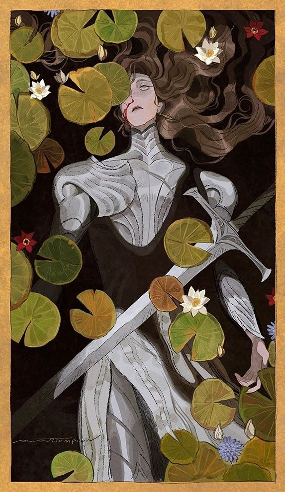

---

<aside>

## Considerações

Essa é a minha tentativa de renovar o sistema porém ainda sem o uso de dados, no final eu vou por uma regra opcional de dado pra quem curte, queira jogar numa possível mesa etc. Mas o intuito principal aqui é ter um sistema apenas narrativo com um pouco de administração de recursos.

Aviso de antemão que removi alguns conceitos do fórum, e outros serão unidos em algo só. A ideia é ter algo simples e funcional mas ainda com a essência do DDW, mesmo que a mecânica acabe completamente diferente.

* Baseado nos sistemas *Fate,* *Chuubo’s Marvelous Wish-Granting Engine, nos diversos Manwhas que eu li e nas vozes da minha cabeça .*

</aside>

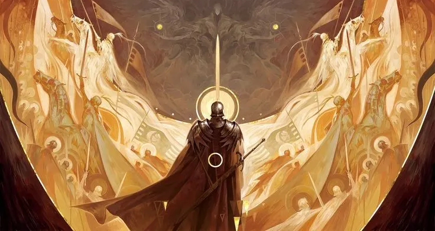

---

# Atributos e Habilidades

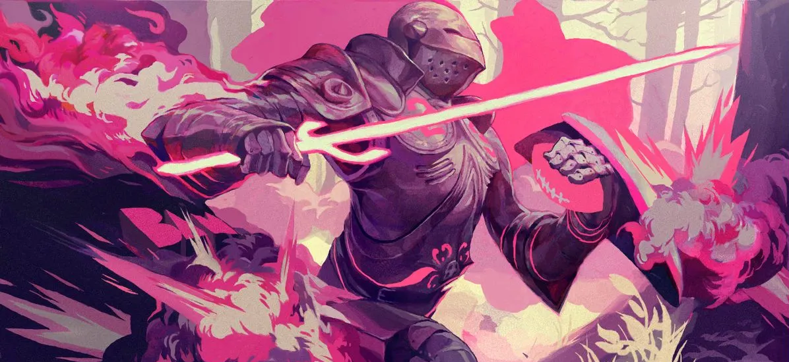

Atributos são uma descrição simples do que a sua personagem é proficiente em fazer. Em alguns RPGs atributos são usados como bônus nas jogadas, neste sistema no entanto eles servem como habilitadores para as suas reais habilidades.

Cada atributo tem um foco de roleplay diferente, os **5 atributos** são:

<aside>

### Causalidade

**Valor Inicial**: 0

Causalidade mede quanta influência sua personagem tem no mundo ao seu redor, quanto mais dessa influência, mais “o mundo” te protege. Personagens com alta Causalidade são tidas como as protagonistas de Erwood.

Este atributo é basicamente sua “proteção”, quanto mais Causalidade uma personagem tem mais difícil é de suceder em ações que a prejudiquem.

</aside>

<aside>

### **Arcanismo**

**Valor Inicial**: 0

Arcanismo trata-se não apenas de conhecimento mágico, mas também da capacidade de manipular a Autoridade da Deusa Mana, um presente dado aos mortais em troca de seu sacrifício.

Personagens utilizam arcanismo para identificar, aprender e lançar magias. Também é a habilidade determinística que lhe dá afinidade em utilizar itens mágicos.

</aside>

<aside>

### Proeza Marcial

**Valor Inicial**: 0

Trata-se do poder adormecido dentro de cada mortal capaz de rivalizar com os deuses. Mestres marciais não só possuem total controle do próprio corpo como também são capazes de realizar escalas físicas inimagináveis.

Personagens utilizam da Proeza Marcial para utilizar feitos físicos absurdos. Também é o atributo responsável pelos limites do seu corpo, em outras palavras um artista marcial consegue aguentar mais porrada, mais dor e mais buffs.

</aside>

<aside>

### Fé

**Valor Inicial**: 0

Fé não se trata apenas de adorar os deuses. É acreditar numa força maior que guia o teu caminho. Seja uma divindade, um patrono, um voto ou sua ancestralidade, ter fé é crer no poder destes laços para realizar milagres. Personagens de Fé não são poderosos por si só, mas são o canal daquilo que acreditam, e quanto maior sua crença, maior o milagre.

Personagens utilizam de Fé para realizar milagres. Ter Fé também é a habilidade determinística que lhe permite acumular Talentos Divinos.

</aside>

<aside>

### Genialidade

**Valor inicial:** 0

É a capacidade de resolver problemas sem a ajuda do “sobrenatural”. Seja por um dom nato ou por anos de dedicação exaustiva, personagens com alta Genialidade enxergam as engrenagens do mundo — sejam elas feitas de ferro, papel ou palavras.

Personagens utilizam Genialidade para interações pessoais, governar, instruir e criar.

</aside>

## Distribuindo Atributos

Cada personagem inicia com dois pontos para investir entre *Arcanismo*, *Proeza Marcial, Fé* e *Genialidade,* estes atributos determinam o foco da sua personagem.

É possível aumentar seus atributos nos níveis 4 e 8. Também é possível “treinar” dentro do próprio jogo e ganhar títulos que aumentam seus atributos enquanto equipados. Para mais detalhes confira a sessão de Progressão de Personagem.

## Habilidades

Diferente dos 5 atributos, não existe uma lista pré-determinada de habilidades. Elas são criadas e determinadas pelo próprio jogador, a única restrição é que essas habilidades não tem texto descritivo, seu nome e propósito devem ser determinados em uma pequena sentença.

Por exemplo uma personagem pode criar para si a habilidade “*Furtividade”*, assim como uma outra personagem pode criar “*Detectar Presença*. Estes são termos mais comuns e conhecidos, mas também é possível ir além e ter algo mais elaborado e específico como “*Especialista em cozinhar pelado de avental”*, tu é um cara muito bom quando o assunto é cozinhar só de avental.

Essas habilidades únicas também servem de habilitadores para magias, técnicas marciais e milagres que serão explicados logo mais. Por exemplo, se você quer ter uma magia de ressurreição profana, você vai precisar ter não só pontos em *Arcanismo* mas também em algo que te habilite a ressuscitar os mortos, como uma Habilidade chamada “*Necromancia”*.

## Distribuindo pontos e criando Habilidades

Após determinar seu foco, cada personagem recebe inicialmente 8 pontos para criar/distribuir em até 6 Habilidades. Não se preocupe se você não souber todas as 6 que quer de imediato, **caso ainda esteja incerto sobre o que colocar, apenas deixe em branco e vá preenchendo a medida que joga e conhece melhor sua personagem**.

Toda habilidade quando criada começa em 0 pontos e pode chegar até +5, sendo o valor máximo na criação de ficha até +3. Segue abaixo o significado de cada pontuação:

|  -1 | Você não é muito bom nisso, mas tenta mesmo assim. |
| --- | --- |
| +0 | É familiar com o assunto mas não passa muita confiança. |
| +1 | Conhece os detalhes de como funciona. |
| +2 | Você é bom nesta habilidade. |
| +3 | Seu nível chegou ao de um profissional. |
| +4 | Um em um milhão, seu talento é o de um prodígio. |
| +5 | Suas habilidades neste campo são lendárias. |

<aside>

Embora toda habilidade comece no 0, sobre circunstâncias especiais você pode utilizar Habilidades que não possui com o bônus de -1.

</aside>

Tenha em mente que apesar das Habilidades serem verdades absolutas, elas não são poderes absolutos, assim como não fazem feitos absurdos por si só. Por exemplo: mesmo que uma personagem tenha a habilidade “mato em um golpe só”, isso não significa que todo seu inimigo ira morrer em um golpe. É importante saber interpretar o contexto da habilidade. “Mato em um golpe só” seria uma ótima habilidade para assassinatos ou atacar pontos vitais num combate, mas ela por si só não lhe garante sucesso.

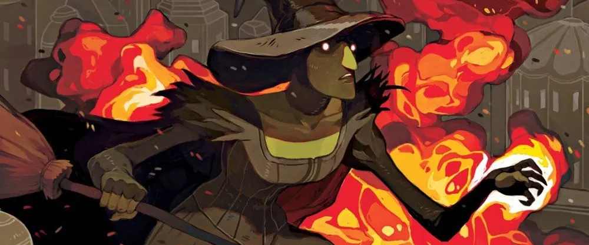

---

# Iniciando Ações

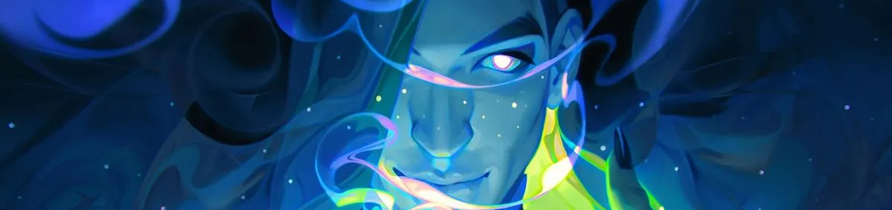

Haverão momentos em sua aventura que são decisivos para a trama. Pense por exemplo que sua personagem é um ladrão, incumbido de se infiltrar na Companhia Mercante e roubar a caderneta de finanças.

Neste cenário você precisará entrar na sede do local sem ser percebido com uma de suas habilidades: *Furtividade*, infelizmente a segurança do local é extremamente apertada e os guardas lhe perceberam, com um pensamento rápido, você decide *Blefar* para ganhar, dizendo ser um inspetor testando a segurança.

No exemplo acima, existem dois momentos decisivos que definem o rumo que a história irá tomar. O primeiro deles é na tentativa de furtividade, e o segundo no blefe. São nesses momentos que você como jogador deve tomar uma ação gastando *Pontos de Ação.*

<aside>
❗

Toda personagem possui 8 pontos de ação por cena.

</aside>

A cada ação você pode gastar **0, 1, 2, 4 ou 8** Pontos de Ação. Quanto mais pontos você gasta, mais exaustivo é para a sua personagem física e mentalmente. Fazer ações com 0 pontos no entando, consomem uma caixa de stress (mais detalhes na sessão de combate).

Os pontos de ação gastos somam-se ao bônus da Habilidade utilizada e os resultados de sua ação são determinadas pela tabela abaixo:

| < 0 | Ruína | Desastroso, sua tentativa apenas piorou tudo! |
| --- | --- | --- |
| 0 | Fracasso | Você falhou, mas nem tudo está perdido. |
| 1 | Complicação | Êxito com consequências. |
| 2 | Sucesso | Sucesso! Sem mais nem menos. |
| 3 | Competente | Bom, seu desempenho será notado. |
| 4 | Reconhecido | Pessoas comentarão umas com as outras sobre o que você fez. |
| 5 | Singular | Você deixou uma forte impressão nas pessoas ao seu redor. |
| 6 | Mestre | Sua maestria é inegável, e alguns começam a contar histórias sobre isso. |
| 7 | Lenda | Um feito lendário! Seu nome será lembrado por aqueles que testemunharam. |
| 8 | Imortalizado | Seu ato entra para a história, e até os bardos começam a cantar sobre ele. |
| 9 | Divino | Executado com tamanha perfeição que você chamou a atenção dos deuses. |

É claro que nem toda situação se encaixa nessas descrições exatas, mas já dá pra saber o nível de competência de cada número final.

<aside>
❗

O bônus somado por habilidades são limitados pelo atributo. Por exemplo: Se seu atributo em Arcanismo for 2, mesmo que tenha uma habilidade de “Mago do Fogo” no nível 5, o máximo que essa habilidade irá somar aos seus pontos de ação é 2.

Encare isto como se o nível da habilidade fosse seu potêncial e o atributo a limitação de seu corpo. Mas não se preocupe, seu limite pode ser superado através de Talentos.

</aside>

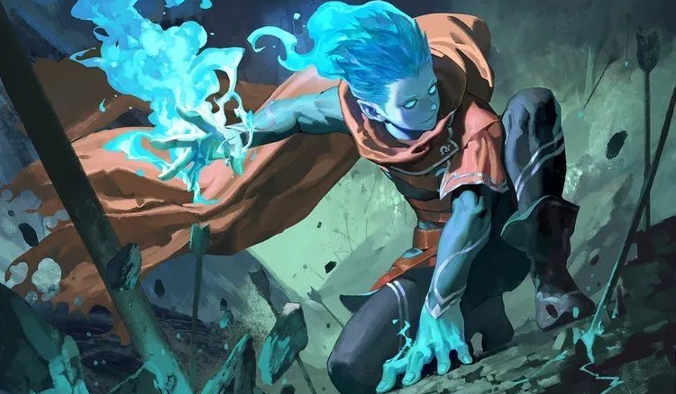

## Obstáculos

Obstáculos são uma mecânica que representam a impraticabilidade da ação que você quer executar. Talvez você seja um ladrão, com poderes de entrar na sombra, furtivo e com botas mágicas que removem o som dos seus passos. Ok, se infiltrar na companhia mercante não seria obstáculo nenhum na realidade. Porém se você for um cara com armadura de placas de metal, onde sempre que anda parece que tem panela batendo e sua espada brilha no escuro? Aí vai ser mais difícil se infiltrar sem ser notado.

Os níveis de dificuldade subtraem em sua ação e seguem a seguinte tabela:

|  0 | **Fácil** — Desafio simples, que qualquer personagem pode tentar sem grandes riscos. |
| --- | --- |
| -2 | **Moderado** — A tarefa exige um pouco de foco, mas ainda é bem acessível. |
| -4 | **Restritivo** — Requer alguma habilidade ou atenção, mas ainda é algo que a maioria pode alcançar. |
| -6 | **Profissional** — Um desafio que começa a exigir uma habilidade mais refinada ou algum conhecimento específico. |
| -8 | **Difícil** — Requer um esforço considerável. Personagens mais experientes tem boas chances de sucesso, mas não é garantido. |
| -10 | **Desafiador** — Um teste que demanda habilidade e um pouco de sorte. Falhas tem grandes consequências. |
| -12 | **Brutal** — Um grande desafio, que exige grande habilidade ou recursos. Sucesso é improvável para iniciantes. |
| -14 | **Impossível** — Somente personagens extremamente habilidosos ou bem equipados têm chances de sucesso. |
| -16 | **Heroico** — Requer um nível excepcional de habilidade, sorte e circunstâncias favoráveis. Erros podem ser catastróficos. |
| -18 | **Divino** — Um desafio extremamente raro ou sem chance real de sucesso. |
| -20 | **Cósmico** — Feitos que desafiam as leis da natureza e afetam a realidade em larga escala. |

<aside>
❗

A *Causalidade* do alvo que você está tentando afetar também se soma ao Obstáculo, como uma espécie de defesa passiva.

</aside>

## Mitigando Obstáculos

### Utilizando duas ou mais habilidades por ação

Existem algumas formas de reduzir as penalidades sobre suas ações, uma delas é utilizando mais de uma habilidade na mesma ação. Habilidades utilizadas para “suporte” mitigam a difculdade de acordo com seus níveis:

| 1 ~ 2 | 1 |
| --- | --- |
| 3 ~ 4 | 2 |
| 5 | 3 |

Continuemos com o exemplo do ladrão tentando se infiltrar: previamente estabelecemos que ele possui a habilidade *Furtividade* digamos, em +3, mas supomos também que ele bebeu uma poção de invisibilidade, garantindo a ele *Invisibilidade* +1.

Neste caso, ao executar a ação de infiltração, ele pode usar em conjunto *Furtividade* e *Invisibilidade*. Porém essas duas habilidades não se somam, a menor habilidade serve apenas para combater a dificuldade. Então se a dificuldade da infiltração for 6 (brutal), então a habilidade de *Invisibilidade* reduzirá a dificuldade para 5 (Desafiador).

Da mesma forma, se a dificuldade for 0, mesmo que o ladrão utilize *Furtividade* + *Invisibilidade*, a invisibilidade não garantirá benefício nenhum, pois a dificuldade já é zero.

<aside>
❗

Note que você pode acumular quantas habilidades fizerem sentido, por exemplo: *Furtividade + Invisibilidade + Silencioso + Super velocidade*.

Porém apenas uma habilidade auxiliar de toda a composição reduzirá a redução de dificuldade. As restantes apenas contribuem narrativamente.

</aside>

<aside>
❗

Também é possível que outras personagens te auxiliem em sua ação, somando suas habilidades utilizadas na redução de dificuldade.

</aside>

### Utilizando Causalidade

Outra forma de diminuir a dificuldade é invocando seu próprio protagonismo no mundo. X vezes por tópico, sendo X sua própria Causalidade, você tem o direito de usar sua Causalidade como um redutor de dificuldade. Para este caso não há limite, se sua causalidade for 5, você irá diminuir 5 pontos.

<aside>
❗

É importante ressaltar que no turno em que sua personagem estiver usando Causalidade para complementar uma ação, ela não estará sendo protegida pelo mundo, e portanto não poderá utilizar Causalidade como defesa passiva.

</aside>

---

## Pontos de Ação, Ações e Recuperação

Note que seus 8 pontos de ação são **por cena**, não por turno/post. Isso significa que você vai ter que administrar seus pontos de ação ao longo de vários turnos. Ao trocar de cena, seus 8 pontos são reestabelecidos.

### Mas afinal, o que é uma Cena?

Uma cena narrativa é um momento completo na história, digamos: Os aventureiros entram no bar, comem, bebem, pedem informações e vão embora. Não importa quantos turnos levaram, esta é uma cena. Outros exemplos incluem uma cena de infiltração no castelo, uma cena de banho nas fontes termais 😳, enfim.

Nem toda cena é necessariamente um lugar novo, as vezes diversas cenas acontecem num mesmo lugar. Por exemplo numa aventura de mistério, um assassinato acorre no decorrer do baile de gala. O baile é uma cena, ao descobrirem o corpo, onde as personagens partem para a investigação, já é outra cena. Por fim o culpado é encontrado, e inicia-se um embate para capturá-lo enquanto o mesmo tenta fugir ou lutar de volta, esta seria uma terceira cena.

No caso da taverna, por exemplo, talvez uma briga de bar tenha eclodido, e com a chegada do combate, talvez seja interessante para a aventura considerar a briga como uma nova cena. Assim como a briga poderia se manter na mesma cena, não há exatamente um momento definitivo para a troca, as vezes uma narrativa de viagem, passando rapidamente por várias floretas e vilarejos até o grupo de fato encontrar algo relevante seja uma cena completa!

Normalmente uma cena muda quando uma das coisas abaixo acontecem:

- Houve uma troca relevante de cenário;
- Algo ou alguém totalmente novo apareceu, mudando o foco da narrativa;
- Após toda uma cena de antecipação, aquele combate importante está prestes a começar;
- Passagem de tempo.

Basicamente uma Cena é trocada quando há uma mudança drástica na narrativa. Fica a cargo do narrador decidir quando essa troca é feita, e no caso de aventuras autonarradas, os participantes devem conversar e chegar à um consenso de quando trocarem de cena.

### Recuperando pontos após Ações

Outra forma de recuperar pontos de ação é, bem, através de ações! Ao finalizar uma ação, ganha-se de volta metade dos pontos investidos (arredondando para baixo). Ou seja, uma ação de 2 pontos retornará 1, uma de 4 retornará 2, e assim por diante. Porém tenha algo em mente: você só recebe os pontos de volta quando a ação for concluída ou interrompida.

Isso porque ainda há um pequeno detalhe a ser explicado:

### Ações podem ser duradouras

O queisso quer dizer? Bom, algumas ações podem durar mais de um turno para serem concluídas, e enquanto ela estiver em ação seus pontos se manterão reservados. Isso também significa que você não precisa reinvestir seus pontos para manter uma mesma ação.

**Exemplo 1:** Um grupo de aventureiros está fugindo de uma dungeon perigosa, porém duas armadilhas são ativadas, e enquanto monstros surgem de um lado, a única porta de saída começa a se fechar. Enquanto seus amigos lutam contra as bestas, o Bárbaro decide correr até a porta e iniciar uma ação de segurá-la com sua habilidade *Força Indômita.* O combate foi finalizado em um turno, porém o grupo não passou pela porta ainda, o Bárbaro no próximo turno tem a opção de segurar seus pontos gastos e manter-se segurando a porta até que todos passem.

**Exemplo 2:** Uma Kitsune usa sua habilidade de *Metamorfo* para se transformar num soldado e infiltrar-se na torre da guarda. Durante toda a cena de infiltração em que a Kitsune quiser manter-se transformada, ela estará segurando seus pontos gastos para manter sua transformação duradoura.

**Exemplo 3:** Durante o combate um Clérigo de Rihla aplica um buff em seus companheiros. Diferente do nosso sistema antigo, onde o buff desapareceria após uma única ação, agora enquanto ele segurar seus pontos gastos, o buff será duradouro.

---

# Talentos

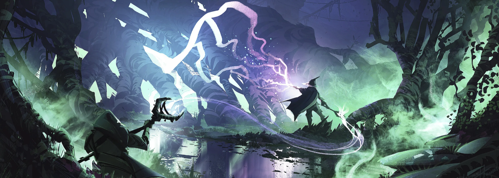

<aside>

Para quem já é familiar com o sistema antigo do DDW, os talentos aqui não são *tão* diferentes. Porém agora são mais sistematizados e agregados as técnicas.

</aside>

Talentos são as características especiais da sua personagem, eles representam suas capacidades extraordinárias assim como seus limites dentro de uma aventura. Eles são derivados de conceitos já existentes de sua personagem, como: Classe, Religião, Raça, Grupo, Contratos ou algo totalmente inato.

<aside>

Cada personagem pode iniciar com até 3 talentos.

</aside>

## Tipos de Talentos

Da mesma forma que cada personagem é singular, também temos uma variedade de tipos de Talentos para tentar acompanhar esse espectro. A formatação básica de todos os Talentos são similares, porém algumas categorias possuem regras e formas diferente de serem montadas.

**Os tipos de Talentos são:**

- **Talento Mágico;**
    - Utiliza Arcanismo junto de alguma outra Habilidade.
- **Talento Marcial;**
    - Utiliza Proeza Marcial junto de alguma Habilidade.
- **Talento Milagroso;**
    - Utiliza Fé junto de alguma outra Habilidade
- **Talento Contratual;**
    - Patronos, Servos e Invocações.
- **Talento Inato;**
    - Dá ao seu personagem um conceito único;
    - Não é baseado em um atributo;
    - Pode alterar o sistema.
- **Talento Racial;**
    - Pré-montado pelo sistema;
    - Relacionado a sua raça;
    - Opcional.
- **Talento Religioso.**
    - Pré-montado pelo sistema;
    - Relacionado ao seu deus ou príncipe infernal;
    - A entidade deve lhe agraciar para recebê-lo;
    - São temporários.
- **Talentos de Fabricação;**
    - Engloba **Alquimia** e **Artifício**.
    - Possui regras extras de fabricação de consumíveis e equipamentos.

---

## Criando um Talento

Acredito que a melhor forma de explicar um talento é criarmos um passo a passo, e então irei explicar como utilizá-lo. Então vamos lá.

<aside>
🔥

Um talento começa na construção de suas habilidades, com o conceito da sua personagem. Para esta explicação vamos criar a personagem “Hiita, a Encantadora do Fogo”.

</aside>

### Habillidade Base

Um Talentos comum sempre será baseado em uma Habilidade que sua personagem já possui, portanto Habilidades além de serem utilizadas nos testes de ação, também são habilitadoras para os seus talentos.

Pense assim, uma personagem maga, com especialidade em *Arcanismo* quer criar um talento de “*Ressucitar os Mortos”*, para isso ela precisaria da Habilidade *Necromancia*. Da mesma forma que um guerreiro ao tentar criar o Talento “*Lança que perfurará os céus*” precisa ao menos ter a habilidade “Maestria em Lanças”.

A Habilidade Base serve não apenas como um Habilitador, como também determina o nível do Talento e o bônus que ele provê em uma ação.

<aside>
🔥

Como uma maga, a especialidade inicial de Hiita será distribuída em *Arcanismo.* E para evidenciar seu talento flamejante, ela deve ter habilidades como:

- “*Elementalista de Fogo +3*”
- “Controle de Mana +2”

Como o próprio nome diz, Hiita é uma maga de fogo, então vamos criar o Talentos baseados em sua temática.

</aside>

### Descrição

O nome dos Talentos normalmente devem ser auto descritivos, e portanto, suas descrições devem ser breves, coisa de uma a três linhas no máximo. Se você faz questão de explicar a exata origem ou momento que sua personagem adquiriu este talento, por favor, faça uma aventura autonarrada, de brinde ainda ganha um XPzinho.

<aside>
🔥

### Chama da Pira Sagrada

**Habilidades Base:** Elementalista de Fogo (+3)

**Nível:** 3

**Mitigação:** 3

**Descrição:** Hiita extrai chamas ancestrais de seu artefato que usa como catalisador para magias de fogo.

</aside>

<aside>
🔥

### Piromancia

**Habilidades Base:** Elementalista de Fogo (+3), Controle de Mana (+2)

**Nível:** 3

**Mitigação:** 2

**Descrição:** Permite que Hiita manipule o formato e trajetória do fogo que produz.

</aside>

<aside>
🔥

### Explosão Mágica

**Habilidades Base:** Controle de Mana (+2)

**Nível:** 2

**Mitigação:** 2

**Descrição:** Permite que Hiita agite sua mana em uma explosão, aumentando o alcance para uma categoria acima.

</aside>

É importante ter em mente que os talentos são de efeitos simples. A ideia é que eles sejam “peças de um quebra-cabeça” que você pode combinar para formar efeitos complexos e poderosos.

Hita por exemplo, com esses três talentos, pode utilizá-los individualmente de maneiras diversas. Talvez ela utilize *Chama da Pira Sagrada* como um “lança chamas”, misturar *Chama da Pira Sagrada* com *Explosão Mágica* para moldar uma bola de fogo explosiva ou até mesmo combinar todos os três para conjurar pássaros flamejantes que explodem ao contato.

### Níveis

Como dito anteriormente, o nível de seu Talento é igual ao nível da Habilidade Base utilizada para criá-lo. A cada nível seu talento mantém a mesma funcionalidade porém com uma potência narrativamente maior:

<aside>
🔥

Os níveis da **Chama da Pira Sagrada** de Hiita seriam escritos da seguinte forma:

**Nível 0:** Pode criar uma chama pequenas (intensidade de uma vela) e erremessar.

**Nível 1:** Pode conjurar chamas do tamanho de uma bola de basquete e disparar em linha reta.

**Nível 2:** Sua influência sobre o fogo aumenta, podendo conjurar o suficiente para queimar um cômodo.

**Nível 3:** Ainda mais poder, conjura fogo o suficiente para icendiar uma casa de uma só vez.

**Nível 4:** Suas chamas são o bastante para destruir uma pequena vila.

**Nível 5:** Produz fogo o bastante para incendiar uma grande capital.

</aside>

Não se preocupe se você não tiver ideia para todos os níveis logo de cara, seu talento pode ser escrito todo de uma vez ou de maneira gradual a medida que avança de nível.

Também é bom manter em mente que nem todo talento precisa de progressão narrativa de nível. Por exemplo o talento *Explosão Mágica* de Hiita não precisa ter descrições de nível, já que ela aumenta o nível narrativo de outros talentos.

### Talentos com mais de uma Habilidade Base

As vezes alguns talentos podem demandar a combinação de duas habilidades. Por exemplo um guerreiro com as Habilidades *Esgrima* e *Afinidade com Fogo* pode querer criar o Talento “*Espadachim Flamejante”*, juntando as duas habilidades.

Neste caso, quando ele for fazer uma ação, será utilizado o bônus numérico da maior habilidade. No entanto, quando utilizar este “talento composto” para mitigar a dificuldade, considera-se o menor valor.

Então se nosso exímio guerreiro tem *Esgrima +3* e *Afinidade com fogo +2*, o bônus de *Espadachim flamejante* será +3, porém quando estiver mitigando dificuldade será +2.

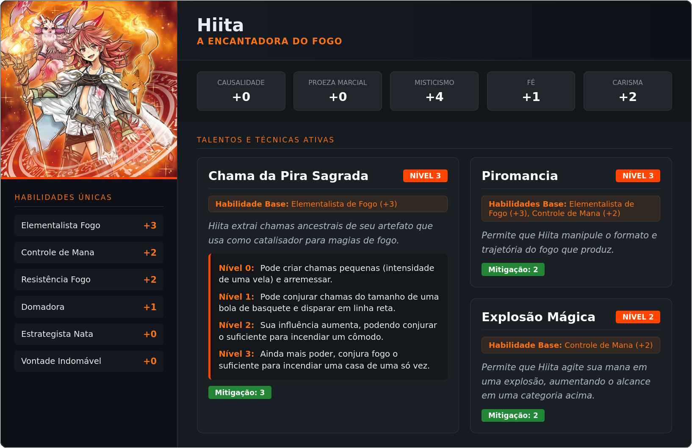

## Utilizando um Talento

Como você deve ter visto na criação, Talentos dizem o que você pode e não pode fazer. Para utilizar um talento em uma ação, você soma ele aos Pontos de Ação gastos.

 

<aside>

Diferente de Habilidades, Talentos não são limitados por atributos. Um Talento de nível 5 sempre irá somar 5 de bônus em ações.

</aside>

Talentos funcionam apenas como poderes passivos, mas também determinam suas magias, técnicas marciais e milagres. Diferente do sistema antigo, onde para fazer algo relevante com o seu poder era necessário criar uma magia/ougi de rank elevado. Agora você pode narrar suas ações de acordo com a combinação de talentos.

### Isso quer dizer que eu não posso mais fazer magias prontas?

Não! As magias não foram totalmente embora, você só não é mais obrigado a utilizar elas. Porém ainda podem ser criadas normalmente, e é até recomendado, pois essas ações “pré prontas” podem ganhar *Títulos* que lhem dão benefícios. Para mais desalhes leia a sessão de *Níveis e progressão*.

### Talentos também podem diminuir a dificuldade

Assim como nas habilidades, ao preparar uma ação o jogador pode utilizar diversos talentos juntos. Neste caso utiliza-se o mesmo esquema, o talento principal soma-se aos pontos de ação gastos, enquanto os auxiliares mitigam a dificuldade.

A principal diferença entre utilizar Habilidades e Talentos como auxiliar, é que ao invés de seguir a tabela de mitigação por nível, o Talento reduz seu nível diretamente na dificuldade.

Talentos auxiliares também ocupam uma “posição” diferente de uma Habilidade auxiliar, desta forma a redução de dificuldade em uma ação pode ser composta por:

**Talento auxiliar + Habilidade auxiliar**

No entranto não é possível combinar uma Habilidade com um Talento que tenha sido baseado nela.

- *Exemplo:* Hiita não pode combinar o talento **Chama da Pira Sagrada** com a habilidade **Elementalista de Fogo**, pois a habilidade já é a fundação do talento. Ela precisaria usar uma habilidade diferente (como *Controle de Mana*) para mitigar a ação.

### Combinação de Talentos e Cooldown

No sistema DDW, os Talentos não possuem cooldown individual fixo; o que entra em tempo de espera são as **Combinações** utilizadas em cada ação. Uma combinação é definida pela lista de Talentos (um ou mais) empregados para realizar um efeito.

Sempre que você realiza uma ação, a lista de Talentos envolvidos torna-se uma **Combinação Bloqueada**. Enquanto essa combinação estiver em cooldown, você não pode repetir exatamente o mesmo conjunto de Talentos, mas pode utilizá-los em novos arranjos.

**Exemplo Prático:**
Imagine que uma personagem possua os Talentos **A**, **B** e **C**.

1. **Uso Isolado:** Ao utilizar apenas o **Talento A**, a combinação `[A]` entra em cooldown. A personagem não pode usar o Talento A sozinho novamente até o fim do tempo de espera.
2. **Uso em Sinergia:** No turno seguinte, ela utiliza **A (Principal) + B (Auxiliar)**. Agora, as combinações `[A]` e `[A + B]` estão em cooldown.
3. **Identidade de Grupo:** A ordem não altera a combinação. `[A + B]` é a mesma coisa que `[B + A]`.

**Opções Restantes:**
Mesmo com `[A]` e `[A + B]` bloqueados, a personagem ainda tem um arsenal variado:

- **B** ou **C** (Novos usos isolados)
- **A + C** ou **B + C** (Novas duplas)

**Duração do Cooldown:**

O tempo de espera de uma combinação é determinado pela intensidade do esforço realizado:

<aside>

**Cooldown = Total de Pontos de Ação (PA) gastos na ação (mínimo de 1).**

</aside>

Se você gastou **4 PA** para incendiar uma sala com o Talento A, a combinação isolada `[A]` ficará indisponível por **4 turnos**. Se gastou **2 PA** em uma sinergia de `[A + B]`, essa dupla fica travada por **2 turnos**.

<aside>

No início de seu turno, o jogador pode marcar **Exaustão** para diminuir o cooldown de uma combinação na mesma medida.

</aside>

<aside>
❗

Talentos utilizados em “ações seguradas”, tem seu cooldown indeterminado até a ação ser liberada.

</aside>

<aside>
❗

Combinar Habilidades com Talentos também geram novas combinações para cooldown.

</aside>

---

# Combate

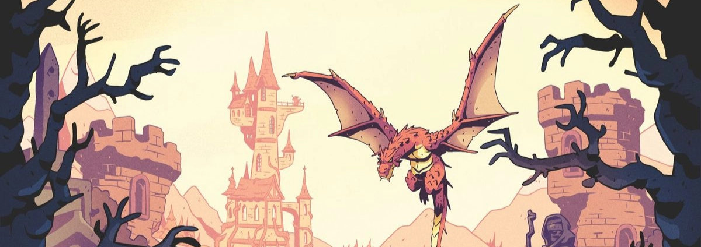

O combate é regido pela gestão de Pontos de Ação (PA) e pela integridade física da personagem, medida através de Estresse e Consequências.

<aside>
❗

Cada personagem pode fazer uma ação Ofensiva e uma Defensiva por turno, sendo que a defesa é uma reação caso seja atacado.

</aside>

### Ofensiva

Para atacar, o jogador deve somar o **PA investido** ao bónus de uma **Habilidade** ou de um **Talento**.

- **Cálculo de Ataque:** `(PA ou Equipamento) + (Habilidade ou Talento)`.

<aside>
❗

Ações de ataque não podem ser seguradas por meios normais.

</aside>

### Defesa

A proteção de uma personagem divide-se em duas etapas:

1. **Defesa Passiva (Causalidade):** É o valor base de proteção. Ataques que não superem a Causalidade são ignorados.
2. **Defesa Ativa (Postura):** O jogador pode segurar uma ação de defesa para se proteger. O cálculo segue a mesma lógica da ofensiva (`(PA ou Equipamento) + Habilidade ou Talento`). Enquanto mantiver a Postura, este valor defende contra todos os ataques. Ao encerrar a Postura, recupera-se 50% do PA investido.
    
    
    A duração da Defesa Ativa é indeterminada, porém o jogador deve encerrá-la se quiser iniciar outra ação qualquer.
    

### Ataque Vs Defesa

Ao se comparar com o ataque, a defesa do jogador é considerada como o **Nível de Dificuldade** da ação do oponente. Portanto, o atacante pode diminuir essa dificuldade através do uso conjunto de Habilidades e Talentos (Sinergia). O defensor, por ser o "obstáculo" da cena, não se beneficia de Talentos Auxiliares para mitigar o ataque recebido, focando-se apenas em aumentar seu valor bruto de Postura.

### Dano e Complicação

O dano é a diferença bruta entre a Ofensiva e a Defesa (`Ataque - Defesa`). No entanto, caso o dano final for **exatamente 1**, o atacante também sofre 1 de Estresse, por ter tido uma “êxito com complicações”

### Estresse e Consequências

O dano é alocado em caixas de **Estresse** com os valores: [1], [2] e [3]. Estes valores correspondem ao quanto de dano cada caixa pode absorver em um único ataque.

Quando uma personagem sofre dano, seu jogador escolhe qual e quantas caixas de **Estresse** irá consumir para receber aquele dano. Caso ainda sobre algum dano, ele será aplicado como uma **Consequência**.

<aside>
❗

**Regra Global de Custos:** Sempre que uma ação exigir a marcação de uma caixa de Estresse (como em Ataques em Área ou ações de 0 PA) e o jogador não possuir caixas disponíveis, ele deve obrigatoriamente receber uma **Consequência**. Caso todos os slots de consequência também estejam ocupados, a personagem entra em **Nocaute** imediatamente.

</aside>

<aside>
❗

Por mais que uma caixa de stresse abrigue um dano menor que o seu limite, ela ainda sera totalmente utilizada. Ex: Ao receber 1 de dano, o jogador que já tem a caixa de estresse [1] marcada decide colocar o dano na caixa [2], essa caixa então é totalmente utilizada como se tivesse recebido dois de dano.

</aside>

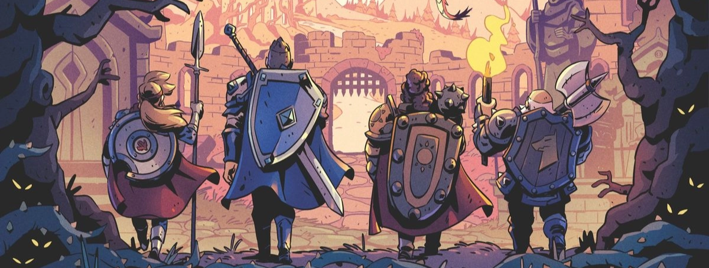

Enquanto o Estresse é o cançaso do combate, a Consequência são ferimentos reais com penalidades. E diferente do Estresse, que é totalmente limpo após um descanso, as Consequência são persistentes até serem curadas narrativamente.

<aside>
❗

Cada personagem possui inicialmente 3 espaços de C**onsequências**.

</aside>

A gravidade de uma consequência é diretamente ligada ao dano recebido. Segue a tabela abaixo como referência:

| Tipo | Dano | Penalidade Mecânica | Recuperação |
| --- | --- | --- | --- |
| **Leve** | Até 2 | -1 em ações relacionadas ao Atributo afetado. | Desaparece no final da cena, contanto que tenha a chance de descansar. |
| **Média** | Até 4 | +2 turnos de Cooldown no Atributo afetado. | Desaparece no final da aventura, desde que faça sentido dentro da história. |
| **Grave** | Até 6 | Bloqueio de Sinergia (não pode usar os Talentos do atributo afetado de forma auxiliar). | Desaparece no final de uma aventura dedicada para a cura. |

Referente ao “Atributo Afetado” citadas na tabela: Quando uma Consequência é **atribuída**, a depender do cunho narrativo do dano, ela afetará um de seus atributos, aplicando a penalidade a todas as Habilidades vinculadas e, por consequência, aos seus Talentos.

Ex: Um guerreiro sofre um ataque que resulta em uma consequência física, logo sua Proeza Marcial e todas as Habilidades relacionadas receberão a penalidade dessa consequência. Da mesma forma um arcanista que receba dano em sua capacidade de lançar magia ou um devoto tenha sua fé abalada.

Note que a categoria da penalidade não é exclusiva por profissões. Um mago ainda pode receber uma penalidade física, apenas não seria tão punitivo quanto em um guerreiro.

O **Nocaute** ocorre quando o dano excede todos os recursos de absorção disponíveis.

### Conceder o Golpe

Antes do cálculo de dano, o defensor pode optar por **Conceder**. Ele abdica da Defesa Ativa, utiliza apenas a Causalidade e aceita o dano total. Em troca, recupera imediatamente **50% do PA gasto pelo atacante** naquela ação.

### Ataques em Área

Ataques de grande escala permitem atingir múltiplos alvos simultaneamente. Ao realizar um ataque em área, o autor deve **marcar uma caixa de Estresse** e pode somar o valor de seu **Atributo** utilizado a jogada de ataque.

O bônus do Atributo é dividido igualmente entre o número de alvos que possuam **Causalidade igual ou superior** à do autor.

- **Alvos com Causalidade Inferior:** Não contam para a divisão do bônus, mas sofrem o ataque com o bônus total resultante da divisão dos outros alvos.
- **Arredondamento:** O resultado da divisão é sempre arredondado para baixo. Se o número de alvos "pesados" for maior que o bônus, o bônus torna-se 0.

**Exemplo:**

<aside>

Um mago com 3 de Arcanismo e 1 de Causalidade decide lançar uma grande explosão em área, ele consome uma caixa de stresse e faz a jogada com 2 PA + 3 (nível de seu talento). Agora vamos considerar os seguinte cenários baseados em seus alvos:

1. **Três alvos de causalidade 1:** O bônus de arcanismo é dividido por três, aumentando em +1 na jogada de acaque contra cada alvo.
2. **Dois alvos de causalidade 1:** O bônus é dividido por dois, mas como não é possível ter o bônus de 1.5, ele é arredondado para baixo. aumentando em +1 na jogada de acaque contra cada alvo.
3. **Quatro alvos de causalidade 1:** Como o número de alvos é maior que o bônus, ele é zerado, porém o ataque em área ainda é efetuado.
4. **Três alvos de causalidade 1 e Um de causalidade 0:** Como o alvo de Causalidade inferior não conta para a divisão, o bônus dividido por três fica sendo +1 contra todos, incluindo contra o alvo de causalidade 0.
5. **Cem alvos de causalidade 0:** Por todos serem de causalidade inferior ao atacante, o bônus não é dividido, aumentando em +3 na jogada de ataque contra todos os alvos.
</aside>

---

# Progressão de Personagem

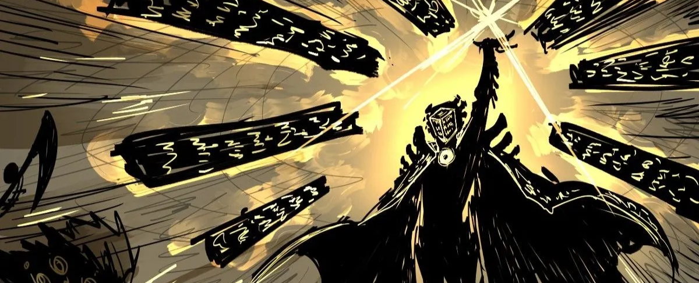

O desenvolvimento de uma personagem é medido pelo seu **Nível (1 a 8)**. A evolução não utiliza pontos de experiência numéricos, mas sim o sistema de **Marcos Narrativos**:

| **Patamar** | **Marco** | Posts |
| --- | --- | --- |
| Níveis 2 ~ 4 | Conclusão de objetivos menores ou missões. | 15 |
| Níveis 5 ~ 7 | Conclusão de arcos de história regionais ou pessoais. | 20 |
| Nível 8 | Conclusão de uma grande saga ou arco mundial. | 25 |
| Convergência | Realizar um feito marcante na história. |  |

<aside>
❗

Além do Marco Narrativo, é necessário ter realizado um determinado número mínimo de posts para alcançar cada nível.

</aside>

### Ganhos por Nível

A cada novo nível, a personagem fortalece suas capacidades técnicas. **Para a criação de personagem, ignore o Nível 1 desta tabela.**

| Nível | Ganhos |
| --- | --- |
| 1 | +1 Ponto de Habilidade
+1 Slot de Talento |
| 2 | +1 Ponto de Habilidade |
| 3 | +1 Ponto de Habilidade
+1 Slot de Talento |
| 4 | +1 Ponto de Habilidade
+1 Ponto de Atributo
+1 Caixa de Estresse (valor [Causalidade + 1]) |
| 5 | +1 Ponto de Habilidade
+1 Slot de Talento |
| 6 | +1 Ponto de Habilidade |
| 7 | +1 Ponto de Habilidade
+1 Slot de Talento |
| 8 | +1 Ponto de Habilidade
+1 Ponto de Atributo
+1 Slot de Consequência |

<aside>
❗

**Nota sobre Habilidades:** Os pontos ganhos por nível devem ser investidos em Habilidades já existentes na ficha ou em habilidades aprendidas através de interpretação (RP) com outras personagens.

</aside>

### A Convergência

Ao atingir o Nível 8, a personagem alcança o ápice do seu desenvolvimento pessoal. Para progredir, ela deve quebrar as barreiras de suas limitações e realizar um **Feito Marcante** na história do mundo, forçando uma **Convergência**. Nesse estado, o Nível reseta para **1**, e a personagem recebe bônus permanentes que elevam sua existência.

**Bônus de Convergência:**

- **Causalidade:** +1 ponto permanente (Defesa Passiva).
- **Reserva de Energia:** +2 no total de Pontos de Ação (PA).
- **Novas Habilidades:** +3 Slots para criar Habilidades.

---

### O Caminho da Divindade: Apoteose

A Causalidade é o marcador do quanto sua existência importa para o mundo. Uma vez que uma personagem alcance **Causalidade 5**, sua próxima Ascensão não resultará em um reset comum, mas sim o início do caminho para se tornar uma **Divindade**.

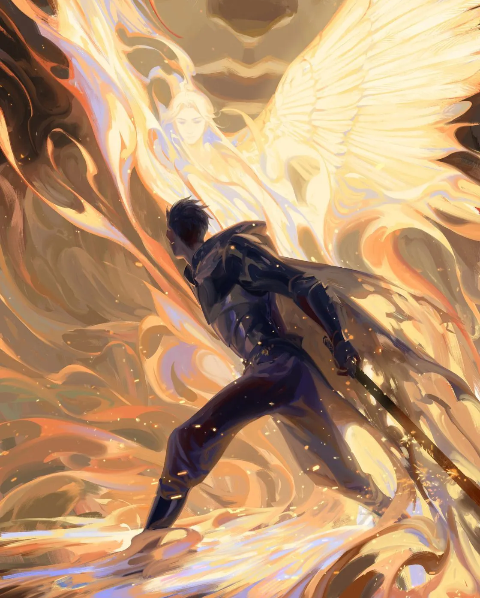

---

# Sistema de Títulos

Os Títulos são condecorações mecânicas e narrativas que materializam os feitos, a fama e a especialização de uma personagem. Eles funcionam como "slots de identidade" que o jogador pode equipar para adaptar suas capacidades a diferentes contextos.

### Regras de Uso

- **Slots:** Cada personagem possui **5 espaços** para equipar Títulos ativos.
- **Gestão:** A troca de Títulos deve ser feita entre aventuras.
- **Níveis:** Títulos progridem do nível **1 ao 5**, escalonando seus benefícios conforme a relevância do feito se repete ou se intensifica.

### Exemplos de Títulos

1. **Mestre de Esgrima (Ação):** Ao utilizar a Habilidade de Esgrima, o bônus de **Proeza Marcial** é aumentado em +2 para esta ação específica.
2. **Carrasco (Dano):** Se o alvo estiver sob efeito de uma Consequência Média ou Grave, seu dano final contra ele aumenta em +2.
3. **Famoso em Adaggio (Social):** Recebe bônus em testes de Interação social com NPCs residentes do Reino de Adaggio.
4. **Explosion!!! (Cooldown):** Reduz o Cooldown da técnica “Explosão”.

### Tabela de Progressão de Títulos

Cada título evolui de acordo com a sua categoria. O mestre define qual coluna se aplica ao título conquistado.

| Nível | Bônus Numérico (Atributo/Dano/Social) | Redução de Cooldown |
| --- | --- | --- |
| **1** | +1 | -1 turno |
| **2** | +2 | -1 Turno |
| **3** | +3 | -2 Turno |
| **4** | +4 | -2 Turnos |
| **5** | +5 | -3 Turnos |

### Personalização e Descoberta

O sistema de Títulos é dinâmico e aberto à sugestão dos jogadores. Sempre que uma personagem realizar algo digno de nota — seja um movimento de combate inédito, uma negociação histórica ou uma demonstração de virtude — ele pode pedir por um título na avaliação.

<aside>
❗

Títulos de Nível 5 podem se tornar "Assinaturas". O nome do título passa a preceder ou substituir o nome da personagem em lendas e documentos oficiais, consolidando sua marca no mundo.

</aside>

---

# Equipamentos

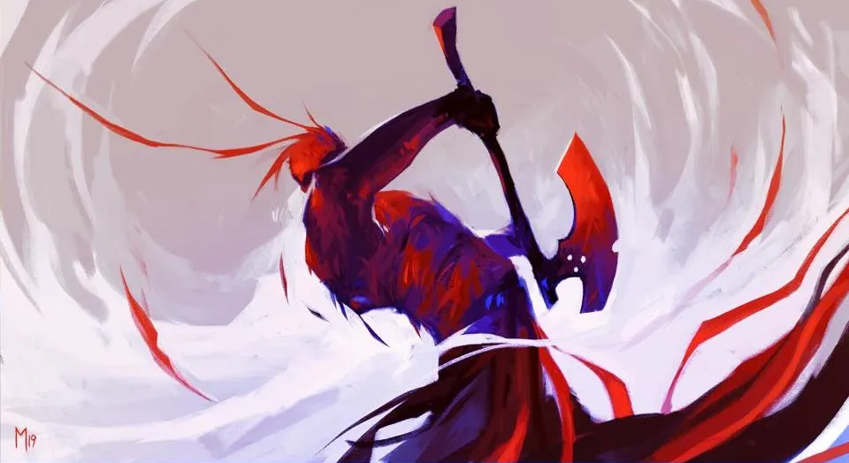

Os equipamentos — sejam lâminas de aço, cajados rúnicos ou artefatos — funcionam como extensões da capacidade da personagem, permitindo que ela execute ações sem consumir sua própria energia/mana (PA).

Equipamentos relevantes possuem um **Nível (1 a 5)** que determina sua potência base.

- **Nível 1-2:** Itens Mundanos ou de boa fatura.
- **Nível 3-4:** Itens Mágicos ou de mestre.
- **Nível 5:** Relíquias Únicas ou Artefatos.

### Utilizando Equipamentos

Ao realizar uma ação (ataque, defesa ou utilitária), o jogador pode optar por utilizar o Nível do Equipamento no lugar do gasto de PA.

**Fórmula da Ação:** `Nível do Equipamento + (Habilidade ou Talento)`

### Durabilidade e Desgaste

Todo equipamento possui uma integridade limitada. A **Durabilidade** máxima é proporcional à qualidade do item:

**Durabilidade Máxima:** `Nível do Equipamento x 2`

(Ex: Um equipamento de nível 5 tem 10 de Durabilidade).

Sempre que um equipamento substitui o PA em uma ação, sua durabilidade é reduzida. O valor perdido é igual à **Dificuldade Final** da ação (após todas as mitigações por Sinergia).

*Exemplo:* Um guerreiro ataca com uma espada Nível 3. A dificuldade (Defesa do alvo) é 5. Ele usa Sinergia para mitigar a dificuldade para 2. Ao final do ataque, a espada perde 2 de Durabilidade.

### Uso Consecutivo e Sobrecarga

Equipamentos não possuem Cooldown, mas desgastam facilmente se usados sem consideração. Se o mesmo equipamento for usado sem que haja um turno de intervalo com gasto de **PA** (Pontos de Ação) entre os usos, o dano na durabilidade dobra exponencialmente:

- **1º Uso:** Dano normal (Dificuldade).
- **2º Uso sem intervalo de PA:** Dano Dobrado (Dificuldade×2).
- **3º Uso sem intervalo de PA:** Dano Quadruplicado (Dificuldade×4).

<aside>
❗

Itens mágicos recebem um escudo de durabilidade temporário no início de cada cena igual ao valor do atributo **Arcanismo** do usuário. Este escudo é consumido antes da durabilidade real do item.

</aside>

### Manutenção e Quebra

A durabilidade de um item pode ser restaurada através de Habilidades de criação. A dificuldade da para reparar é equivalente a durabilidade que se almeja recuperar. Falhar em um teste de reparo irá quebrar o item.

Se a Durabilidade de um equipamento chegar a **0**, o equipamento torna-se inutilizável e perde seus bônus até ser totalmente restaurado. Se sofrer dano enquanto estiver com 0, o item é destruído permanentemente.

<aside>
❗

Equipamentos de nível 1 e 2 podem ser raparados por NPCs em troca de dinheiro.

</aside>

### Aquisição e Forja

O acesso a equipamentos de qualidade superior é limitado pelo prestígio e pelos recursos da personagem. No mundo de **Erwood**, a economia divide-se entre o comércio mundano e as conquistas lendárias.

| **Nível** | **Categoria** | **Forma de Obtenção** |
| --- | --- | --- |
| **1** | Mundano | Comércio Comum |
| **2** | Boa Fatura | Comércio Especializado / Encomenda |
| **3** | Mestre | Missões / Forja com Materiais Raros |
| **4** | Mágico / Épico | Dungeons Perigosas / Grandes Feitos |
| **5** | Relíquia | Clímax Narrativo / Durante uma aventura que resulte em Convergência |

<aside>
❗

Para mais informações de como forjar equipamentos, visite a sessão de **Talento** **Artífice**.

</aside>

---

# Consumíveis

Consumíveis são itens de uso único, como elixires, poções, pergaminhos e óleos, que oferecem efeitos imediatos ou utilitários. Assim como os equipamentos, eles são regidos por níveis de potência e raridade.

### Níveis e Aquisição

- **Nível 1 (Mundano):** Única categoria disponível para compra direta em mercados. Oferece efeitos básicos.
- **Nível 2 a 4 (Superior):** Não podem ser comprados. Devem ser fabricados por jogadores com Talentos em **Alquimia** (para poções/elixires) ou **Arcanismo** (para pergaminhos e runas), utilizando ingredientes raros.
- **Nível 5 (Lendário):** Exige materiais únicos obtíveis apenas em uma jornada (Ex: Pena de Fênix). Podem realizar feitos milagrosos, como reviver uma personagem ou conceder imortalidade temporária.

### Limite de Uso

O corpo mortal possui um limite para o quanto de substâncias externas ou magia instável conseguem processar em um curto período. Uma personagem pode utilizar uma quantidade de consumíveis por cena igual a sua **Proeza Marcial + 1**.

Ao ultrapassar esse limite, a personagem sofre imediatamente a consequência leve **Overdose**, reduzindo todas os Atributos e Habilidades em **1**. Esta consequência pode ser adquirida múltiplas vezes, ocupando slots de consequência diferentes.

Se a personagem precisar receber uma nova consequência de Overdose e não possuir mais slots de consequência disponíveis, ela entra em **Nocaute** imediatamente.

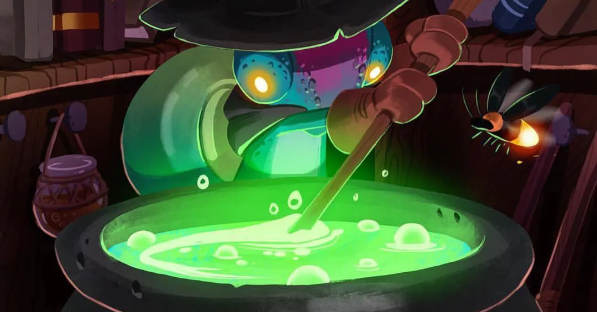

### Exemplos de Consumíveis

| **Nível** | **Efeito** |
| --- | --- |
| **1** | Recupera Estresse [1]. |
| **2** | Remove uma condição de veneno. |
| **3** | +2 em uma Habilidade por uma ação. |
| **4** | Concede Habilidades temporariamente, como Voo, Invisibilidade, Teleporte, etc. |
| **5** | Reviver uma personagem, Criar uma zona de anti-magia, Ampliar a gravidade de um local. |

<aside>
❗

Para mais informações de como criar consumíveis, visite a sessão de **Talento** **Alquímico**.

</aside>

---

# Aprofundando Talentos

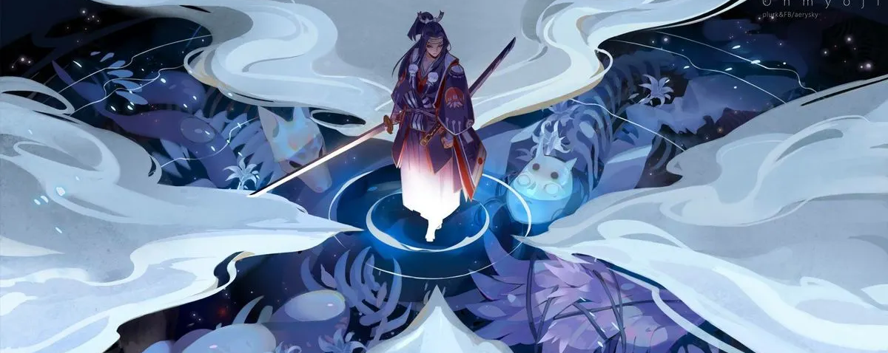

Você já sabe o que são, como criar e como utilizar talentos, agora vamos nos aprofundar em seus efeitos e propriedades.

A maioria dos efeitos possíveis para talentos tendem a ser intuitivos. Como a proposta do sistema é algo orgânico, onde os jogadores vão desenvolvendo seus conceitos com a orientação da Staff, é impossível prever todos os tpos de efeitos a serem criados, porém aqui vão os mais comuns:

## Invocação e Construtos

Caso seu interesse seja de invocações com ficha própria, refira-se a secção de Talento Contratual. 

Construtos referem-se a tudo que não é vivo nem tem vontade própria: Golens, Elementais feitos pelas própria magia do usuário, mortos vivos reanimados sem um ritual, armamentos etéreos, etc.

Para utilizar este tipo de invocação a personagem deve ter um talento relacionado a invocação e **segurar uma ação de invocação.** Isto significa que seus pontos de ação gastos na invocação ficarão “bloqueados” até que a invocação seja desfeita, e o talento em cooldown indeterminado seguindo a mesma regra de segurar ações.

<aside>

O nível da invocação (bônus utilizado no lugar dos PAs) é o mesmo nível do Talento. E a durabiiidade é equivalente ao Nível do Talento + os PAs gastos na ação de invocar.

</aside>

Construtos funcionam como “equipamentos”; possuem durabilidade própria e podem ser utilizados em ações no lugar de Pontos de Ação. Com a durabilidade zerada, a invocação é desfeita.

<aside>
❗

Lembre-se que, como o Construto funciona como um "Equipamento", ele também sofre as regras de **Uso Consecutivo**. Se você usar seu Golem para atacar em três turnos seguidos, o desgaste na durabilidade dele será quadruplicado no terceiro turno.

</aside>

## Cura

A cura é um recurso não apenas precioso como também muito raro em Erwood. Clérigos e curandeiros costumam ser muito bem tratados onde quer que vão, e isso não é a toa. Porém não é absoluta, e ironicamente, muito menos milagrosa. Seu efeito é lento e às vezes doloroso.

<aside>
❗

Ações de cura exigem o investimento **mínimo de 1 PA**. Não é possível realizar curas utilizando apenas a marcação de Estresse (ações de 0 PA).

</aside>

Talentos de Cura funcionam de maneira bem simples, a personagem faz uma **Ação de Cura**, sendo o obstáculo equivalente a quantidade de dano que deseja curar. Ex: Para curar uma caixa de estresse [3], o curandeiro faz uma ação de dificuldade três (3), necessitando um resultado final de dois (2) para ser bem sucedido. Caso seu teste tenha um resultado de 1, a cura é reduzida em um patamar, uma cura de estress [3] viraria [2].

Já quando o alvo de cura são Consequências ao invés de caixas de estresse, saiba que em combate apenas consequências leves são curáveis. E seu obstáculo é igual a quantidade de dano limite da categoria da condição + 2. Ou seja: Consequências **Leves** tem dificuldade 4. Já fora de combate, Consequências **Médias** tem dificuldade 6 e consequências **Graves** tem dificuldade 8.

<aside>
❗

Vale lembrar que mesmo que seja curadas e não dêem mais a penalidade, caixas de consequência ocupadas por consequências **Médias** e **Graves** só serão “limpas” ao final da aventura.

</aside>

## Reforços e Maldições

Ambos os tipos de talento utilizam a mecânica de **Ação Segurada**. Enquanto o efeito estiver ativo, os Pontos de Ação (PA) utilizados para ativá-lo permanecem bloqueados e o talento entra em *cooldown* indeterminado até ser "liberado", passando a conter seu cooldown normal.

### **Reforços**

Melhoram as capacidades dos aliados. O custo inicial é de **1 PA por alvo**. Caso o utilizador invista **8 PA ou mais**, o número de alvos torna-se ilimitado (dentro do alcance narrativo).

<aside>
❗

O corpo de uma personagem alvejada por um reforço só consegue sustentar uma quantidade de reforços ativos igual a sua **Proeza Marcial + 1**.

</aside>

Possíveis efeitos de reforço incluem mas não limitado a:

- Aumento de nível em um tipo de talento (Ex: potencializar chamas);
- Redução de cooldown;
- Redução de dano em tipos de dano (Ex: Resistência a cortes);
- Redução do gasto de durabilidade de equipamentos;
- Melhorar movimentação (Ex: Garantir voo ou andar na água);

<aside>
❗

Reforços de redução não são ilimitados enquanto durarem. Os alvos do reforço recebem uma reserva de “pontos” igual nível do Talento de reforço. Estes pontos são consumidos proporcionalmente durante a redução.

</aside>

### **Maldições**

Funcionam como um ataque direto à integridade do alvo. Para aplicar uma maldição, o autor deve vencer a Defesa do alvo com uma jogada de ação.

Ao acertar, a maldição ocupa **uma caixa de consequência** do alvo. Enquanto a ação for segurada pelo autor, esse slot permanece bloqueado pelo efeito negativo.

<aside>
❗

Se um alvo receber uma maldição e não possuir caixas de consequência livres (seja por ferimentos ou outras maldições), ele é **Nocauteado** imediatamente.

</aside>

Se o autor libertar a ação ou for nocauteado, a maldição cessa e a caixa de consequência do alvo é desocupada. Maldições também podem ser anuladas por talentos específicos de purificação (Ex: anular cegueira, anular lentidão, etc).

Os efeitos possíveis de Maldições são similar aos Reforços, porem de cunho inverso.

## **Efeitos de Produção e Área de Efeito**

Talentos que geram matéria, energia ou elementos seguem uma escala de magnitude baseada em seu nível. Esta escala define o volume de produção e a área máxima que o efeito pode abranger de uma só vez.

| Nível | Escala de Produção / Alcance | Exemplo (Fogo/Energia) | Exemplo (Criação/Artifício) |
| --- | --- | --- | --- |
| **0** | Dimensão de uma palma. | Uma vela ou fagulha. | Um prego ou uma moeda. |
| **1** | Dimensão de uma bola de basquete. | Uma tocha ou projétil focado. | Uma adaga ou ferramenta simples. |
| **2** | Preenche um cômodo. | Incêndio em uma sala. | Uma armadura ou mobília. |
| **3** | Envolve uma casa. | Incendiar uma residência. | Uma pequena cabana ou ponte. |
| **4** | Devasta uma vila. | Tempestade de fogo local. | Uma fortaleza ou muralha. |
| **5** | Atinge uma grande capital. | Cataclismo urbano. | Megaestruturas. |

<aside>
❗

Talentos de produção não discriminam entre aliados, inimigos ou objetos. O efeito afeta **tudo** dentro da escala utilizada. 

</aside>

Para poupar alvos específicos ou "moldar" o efeito (ex: fazer o fogo desviar de um aliado), o utilizador deve combinar a ação com outro talento ou habilidade de **Controle** que possua nível igual ou superior à escala sendo utilizada.

Uma personagem pode possuir um talento de Nível 5, mas optar por manifestar apenas o efeito de Nível 1 para maior precisão ou economia de esforço, o bônus na ação, no entanto, **não** é reduzido.

<aside>
❗

É importante lembrar que mesmo que seus ataques tenham o potêncial de larga escala, a regra de ataques em área ainda entra em vigor normalmente.

</aside>

## **Teleporte**

Teleportação em Erwood é a arte de dobrar o espaço para conectar dois pontos. Diferente dos talentos de produção, o sucesso de um teleporte é ditado pela **Escala de Obstáculo**. O valor negativo é aplicado como um redutor na jogada de ação para realizar o salto.

| Distância / Alcance | Obstáculo (Penalidade) |
| --- | --- |
| **Combate de pequena escala** (Curto alcance) | Moderado (-1) |
| **Linha do horizonte** (Visão direta) | Restritivo (-2) |
| **Entre cidades próximas** | Profissional (-3) |
| **Entre reinos próximos** | Difícil (-4) |
| **Dois reinos de distância** | Desafiador (-5) |
| **Cruzando um continente** | Brutal (-6) |
| **Cruzando o oceano** | Impossível (-7) |
| **Qualquer lugar do plano** | Heroico (-8) |
| **Entre planos** | Divino (-9) |

O teleporte base inclui apenas o conjurador e seus itens pessoais. Para levar aliados, aplica-se a mesma lógica do **Reforço**: o custo **mínimo** aumenta em **+1 PA por passageiro** ou **8 PA** para abrir um portal capaz de transportar um grupo de tamanho indeterminado.

<aside>
❗

Suceder com **Complicação** num teste de teleporte move a personagem para um local aleatório da mesma escala de distância. Teleportar não consome sua ação de combate.

</aside>

## Cópia

Ao presenciar uma Habilidade ou Talento alheio, a personagem com o poder de cópia pode, no intervalo de um turno desde que a ação foi feita, tomá-la para si. Copiar não consome sua ação de combate, porém gasta Pontos de Ação igual ao nível do poder copiado.

A cópia funciona como uma **Ação Segurada**; enquanto o jogador desejar manter o talento copiado à sua disposição, os Pontos de Ação (PA) utilizados para a ativação permanecem bloqueados e o talento entra em *cooldown* indeterminado até ser liberado.

O potencial da técnica copiada é sempre limitado pelo nível do seu Talento de Mimetismo. Por exemplo, um usuário com Mimetismo Nível 2 que tente replicar uma técnica de escala Nível 5 só conseguirá manifestar os efeitos equivalentes ao Nível 2, independentemente do poder original do alvo.

Para que a cópia seja possível, o mímico deve possuir pelo menos **1 ponto** no Atributo do talento que pretende replicar. Tentar copiar um talento de uma base na qual você possui valor 0 resulta em uma falha automática.

<aside>
❗

Talentos Inatos ou Raciais não podem ser copiados, pois são ligados à fisionomia ou à própria existência do ser.

</aside>

O jogador que fizer um bom uso de suas habilidades copiadas pode, ao final da aventura, ser recompensado com um título que, enquanto equipado, lhe permite manter a cópia correspondente ao título sem a necessidade de segurar sua ação.

A ação de copiar pode ser segurada de uma aventura para a outra, mantendo a cópia por tempo indeterminado até que seja liberada.

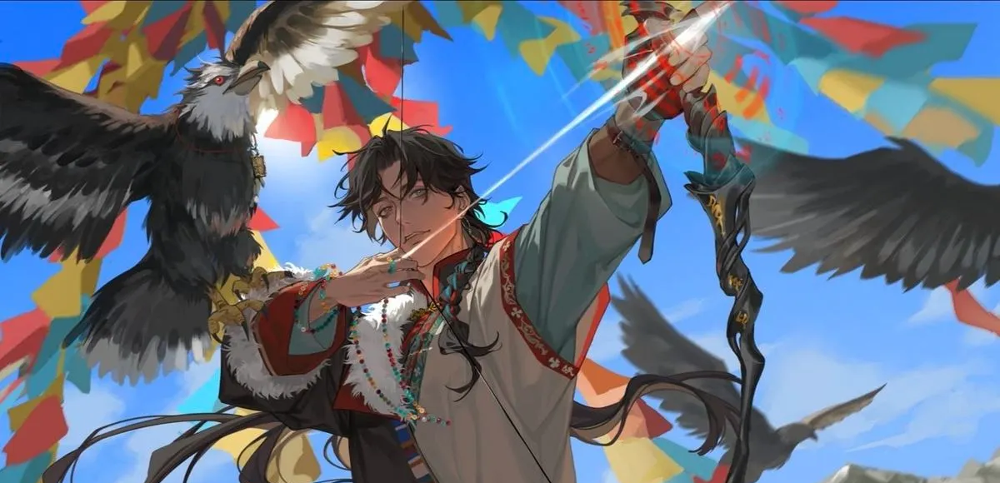

---

# Categorias de Talentos

## Talentos Mágicos, Marciais e Milagrosos

Estes são os tipos de talentos mais comuns no sistema, e geralmente serão utilizados para as funcionalidades mais comuns de combate ou dentro de uma RP. Todos os três são utilizados da forma como as regras de talentos ensinam, e possuem a mesma capacidade de ataque, defesa, reforço e maldição. Há no entanto duas distinções que valem a pena evidencias:

- **Cura:** Dentre os três, apenas Talentos Milagrosos podem ter efeitos de **cura**. Outras categorias de talentos no entanto ainda podem ter efeitos de **purificação**.
- **Teleporte**: Dentre os três, apenas Talentos Mágicos podem ter efeitos de Teleporte.

Diferente de categorias mais complexas, estes talentos são intuitivos: o jogador define o que o poder faz (Efeito) e o nível de impacto que ele causa (Escala), utilizando suas Habilidades Base para determinar o sucesso da ação.

## Talentos Contratuais

Diferente das demais categorias, Contratos não são criados ou aprendidos, mas adquiridos através do contato direto e negociação com entidades. Ao selar um acordo, a personagem recebe uma **Habilidade** referente ao ser contratado (iniciando em -1, podendo ser evoluída normalmente).

<aside>
❗

Uma exceção é durante a criação de ficha, onde um único contrato pode ser estabelecido como Habilidade inicial. Novos contratos só podem ser obtidos durante a narrativa.

</aside>

O **Nível do Talento de Invocação** é determinado pela conexão entre as existências:

<aside>

Causalidade do Jogador + Nível da Habilidade de Contrato - Causalidade da Criatura

</aside>

Este valor varia entre o máximo de 5 e o mínimo de -1. Porém é limitado pela causalidade da entidade. Um contrato com um ser de causalidade 2, por exemplo, só pode chegar até o nível 2.

Criaturas invocadas via contrato possuem fichas e ações separadas de seu invocador, e sua potência é determinada pelo seu nível (limitado pela Causalidade da criatura): 

| Nível | Tipo de Criatura | Estresse | Conseq. | Habilidades | Talentos |
| --- | --- | --- | --- | --- | --- |
| **-1** | Invocação Impossível | - | - | - | - |
| **0** | Manifestação Parcial  ou Habilidade | - | - | - |  |
| **1** | Pequena e Fraca | [1] | 1 | +1, +0 | 1 |
| **2** | Média | [1] [2] | 1 | +2, +1(x2) | 2 |
| **3** | Grande | [1] [2] | 2 | +3, +2, +1(x2) | 3 |
| **4** | Mitológica | [1] [2] [3] | 2 | +4, +3, +2(x2), +1 | 4 |
| **5** | Ápice (Reis/Rainhas) | [1] [2] [3] | 3 | +5, +4(x2), +3, +2 | 5 |

<aside>

No nível 0 o Talento funciona como um Talento normal (Marcial/Arcano/Milagroso).

</aside>

### Regras de Invocação

- **Ações:** A criatura possui uma reserva de Pontos de Ação (PA) exatamente igual à quantidade de PAs que o invocador está **segurando** para mantê-la em campo.
- **Nocaute:** Se a criatura for nocauteada, ela retorna ao seu plano de origem para se recuperar e não pode ser invocada novamente até o fim da aventura atual. Se o invocador for nocauteado ou liberar a ação, a criatura desaparece.
- **Causalidade e Hierarquia:** Caso o contrato seja feito com um ser cuja Causalidade resulte em um nível insuficiente para a invocação completa, o jogador invocará versões enfraquecidas ou subordinados daquela entidade.

<aside>
❗

Vale lembrar que tudo pode acontecer no RP, e entidades podem escolher cancelar o contrato caso o contrato esteja sendo mau utilizado ou os objetivos do contratante sejam contrários à entidade.

</aside>

### Médium

Nem todo contrato precisa necessáriamente de um encontro pessoal, alguns usam rituais, já outros mediums. Um médio é uma ponte de conexão com a entidade, ele pode ser outra criatura que serve como representante ou um objeto/artefato.

Formar um contrato por meio de um médium é uma ótima forma de perssuadir entidades de causalidade muito grande. Uma série de médiums muito populares e cobiçados, porem raros em Erwood, são as chaves de constelações.

<aside>

Um jogador pode receber um médium como recompensa ao final de uma aventura ou evento.

</aside>

### Tipos de Entidades

Em Erwood existem diversos tipos de entidades com o qual se pode fazer um contrato, esta sessão visa exemplificar as mais populares. Entretanto mantenha em mente que as opções de contrato não estão limitadas aos exemplos abaixo.

### Deuses

**Causalidade:** Imensurável (5 ao fazer o cálculo de nível)
**Subordinados:** Arcanjos, Anjos e Santos

É incomum para os deuses fazerem um contrato direto, afinal, eles já abençoam o mundo mortal e garantém benção de muitas outras formas. Porém quando o fazem, é para escolher um arauto que o representará entre os mortais.

Para se tornar o escolhido de um deus, o jogador deve fazer uma jornada épica que resultará em sua convergência, só assim se tornará um arauto. Na história nunca foi registrado a existência de dois escolhidos do mesmo deus vivendo na mesma era.

Deuses menores são mais propensos a terem arautos.

<aside>
❗

O nível mínimo do talento de contrato com este tipo de entidade sempre será 0.

</aside>

### Príncipes do Inferno

**Causalidade:** Imensurável (5 ao fazer o cálculo de nível)
**Subordinados:** Arqui-demônios, Demônios e Infernais

Diferente dos deuses os príncipes do inferno não são muito exigentes com seus contratantes, não só porque seu poder vêm dos contratos mas também porque eles consideram seus contratantes como nada mais do que peões.

Para fazer o contrato com um Príncipe do Inferno é necessário um Médium e um *acordo*. Este acordo é uma relação de servitude entre o Príncipe e o contratante, muito cuidado! Pois apenas o mestre pode quebrar este tipo de contrato.

<aside>
❗

O nível mínimo do talento de contrato com este tipo de entidade sempre será 0.

</aside>

### Dragões

**Causalidade:** Imensurável (5 ao fazer o cálculo de nível)
**Subordinados:** Dracos, Serpes e Quimeras.

Dragões são criaturas que não se envolvem em assuntos mundanos. Sua existência existe para trazer balanço entre os Deuses e Príncipes infernais, e dragões são símbolos de mau presságio, não porque trazem a destruição, mas porque quando um dragão se envolve em algo, isso significa que a situação já se encontra no maior ponto de terror e desespero. Toda vez que alguma lenda, história ou civilização foi apagada dos registros, um dragão estava envolvido.

Apesar de raros, há registros históricos de mortais fazendo contratos com dragões para manter o balanço no conflito entre poderes, estivesse ele pendendo para o bem ou mal, moralidade para guardiões da ordem é irrelevante.

<aside>
❗

O nível mínimo do talento de contrato com este tipo de entidade sempre será 0.

</aside>

### Rei Espiritual

**Causalidade: 5**
**Subordinados:** Espíritos Elementais

Um Rei Espiritual é uma entiade que governa um plano elemental. Existe um para cada elemento, cada um com sua personalidade alinhada ao elemento em si. Suas relações com mortais são neutras, mas tendem a favorecer mortais com alta afinidade ao seu elemento ou espiritualistas talentosos que já possuem contratos com um de seus servos.

### Realeza Fae

**Causalidade: 5**
**Subordinados:** Djinns, Dríades, Duendes e Pixies.

Um contrato com uma criatura Fae nunca fica entediante, o contratante e contratado travam uma guerra sem fim em quem consegue passar a perna no outro e tomar controle do contrato.

O folclore de Erwood, passado de pai para filho, lista algumas peculiaridades que deve-se atentar-se ao lidar com as fadas:

- Nunca diga “Obrigado”. Uma dívida de gratidão pode lhe transformar num escravo;
- Ao comer e beber algo no mundo das fadas, você nunca poderá deixá-los;
- Nunca aceite um presente sem dar algo em troca;
- Fadas não mentem e odeiam mentiras, porém ainda conseguem enganar com verdades imprecisas;
- Descobrir o nome real de uma fada lhe dá influência sobre ela.

Se tais lendas são de fato verdade ou não, poucos tiveram a chance de contar história.

### Outer Gods

**Causalidade: 5**
**Subordinados:** Constelações, Shoggoths e Terrores Desconhecidos.

Pouco se sabe das entidades exteriores, apenas que tentam de alguma forma exercer e estabelecer sua influência no mundo. Não é difícil iniciar um contrato com esses seres, porém você nunca mais será o mesmo.

---

## Talentos de Fabricação (Alquimia e Forja)

Alquimistas e Artífices transformam matéria bruta em potencial puro. Personagens com estes talentos de criação são capazes de preparar o grupo para qualquer adversidade, transformando recursos coletados em jornadas em vantagens táticas.

### Habilidade Base
Tanto Alquimistas quanto Artífices utilizam habilidades vinculadas à **Genialidade**.
- **Alquimistas:** *Alquimia, Botânica, Herborismo, Farmácia* ou *Química*.
- **Artífices:** *Ferraria, Engenharia, Joalheria, Carpintaria* ou *Runologia*.

### A Ação de Produção (Forjando e Preparando)
A criação de um item, seja um consumível alquímico ou um equipamento forjado, exige tempo, infraestrutura adequada e é tratada como uma **Ação de Produção**. O sucesso depende do seu conhecimento, tempo investido (PA) e da qualidade da matéria-prima. 

O nível do seu Talento funciona como um "limitador": você só consegue fabricar itens de nível igual ou inferior ao seu talento.

| Nível do Item | Requisitos de Materiais (Alquimia / Artifício) | Dificuldade da Ação |
| :--- | :--- | :--- |
| **1 (Mundano)** | Componentes comuns / Metais e couros comuns. | 2 (Fácil) |
| **2 (Superior / Boa Fatura)** | Materiais raros locais / Ligas refinadas ou madeiras tratadas. | 4 (Moderado) |
| **3 (Mestre)** | Extrações de criaturas perigosas / Minérios raros e ferramentas precisas. | 6 (Profissional) |
| **4 (Épico / Mágico)** | Materiais de Dungeons / Extração de monstros. | 8 (Difícil) |
| **5 (Lendário / Relíquia)** | Componentes únicos / Materiais lendários. | 10 (Desafiador) |

### Resultados da Produção e Manutenção
Se a rolagem for bem-sucedida, o item está pronto para o uso. 
No caso de um **Fracasso (0 ou menos)**, os materiais são desperdiçados ou arruinados em uma nuvem de fumaça inútil ou peças quebradas.
Se o resultado final for uma **Complicação (1)**, o item possui falhas:
- **Alquimia:** O item é instável. Pode ter um efeito colateral imprevisível ou durar apenas metade do tempo (a escolha do criador).
- **Artifício:** O equipamento possui falhas estruturais, começando com sua durabilidade máxima reduzida pela metade.

**Manutenção Profissional (Exclusivo para Artífices):** Diferente de personagens comuns, o Artífice pode restaurar a durabilidade de itens de Nível 3 ou superior. Ao realizar uma ação de reparo bem-sucedida, ele recupera uma quantidade de durabilidade igual ao seu nível de Talento, sem risco de quebra catastrófica em caso de falha simples (Resultado 0).

### Escolas e Especializações de Ofício
Ao criar seu talento, você escolhe qual "ramo" de fabricação sua personagem domina:

**Escolas de Alquimia:**
- **Panaceia:** Especializada na manutenção da vida. Permite criar elixires de cura, antídotos e substâncias que regeneram as caixas de estresse.
- **Toxicologia:** O estudo das substâncias debilitantes. Focada em venenos, gases paralisantes e misturas que atacam diretamente os slots de consequência do alvo.
- **Piroquímica e Voláteis:** Para quem gosta de soluções explosivas. Criação de bombas, ácidos corrosivos e óleos que aplicam elementos às armas.
- **Alquimia Mutagênica:** Elixires que alteram a biologia do usuário por tempo limitado, garantindo buffs físicos ou habilidades exóticas como Voo e Visão Noturna.
- **Química Utilitária:** O "canivete suíço" do alquimista. Criação de colas, solventes, névoas de ocultamento e ferramentas de suporte variadas.

**Especializações de Artifício:**
- **Armaria:** Focada na criação e reforço de armaduras, escudos e vestes protetoras.
- **Cutelaria:** O domínio das lâminas e armas de impacto, focada em maximizar o alcance e o dano.
- **Artifício Rúnico:** Criação de joias, amuletos e itens utilitários que interagem com o Arcanismo.
- **Engenharia de Cerco:** Construção de mecanismos complexos, balistas e autômatos utilitários.
- **Carpintaria Rúnica:** Especializada em cajados, arcos e instrumentos que servem de catalisadores.

### Renome e Propriedade Intelectual
Mestres em suas artes acabam sendo reconhecidos pelo mundo afora, seja através de **Receitas** ou **Marcas de Forja**.

- **Receitas Alquímicas:** Alquimistas podem publicar artigos acadêmicos sobre suas pesquisas. Ao fazê-lo, sua receita publicada se tornará de conhecimento público, e outros alquimistas poderão replicar sua criação. (Deve-se fazê-lo em uma das universidades de Erwood).
- **Patentes e Marcas de Forja:** Artífices podem registrar sua "Marca de Forja". Equipamentos que portam a marca de um Artífice renomado possuem um **Escudo de Durabilidade** extra (Causalidade do Artífice).

Seja publicando uma receita popular ou forjando um item que se torne lendário na mão de um herói, o criador recebe dinheiro, prestígio e um **Título** de fama que cresce com sua notoriedade. Enquanto o título estiver equipado, a dificuldade ou o custo para obter os materiais e replicar itens daquela mesma categoria é reduzido drasticamente (limitado ao nível do título, máximo de 3).

### Adquirindo Materiais
Todo item de fabricação exige matéria-prima. Embora itens de Nível 1 possam ser comprados em mercados comuns, materiais de Nível 2 ou superior exigem esforço direto do personagem.

- **Nível 1-2**: Podem ser comprados ou coletados em ambientes seguros.
- **Nível 3-4**: Exigem expedições, saques de Dungeons ou extração de criaturas perigosas.
- **Nível 5**: Materiais únicos obtidos apenas através de marcos narrativos ou vitórias épicas.

#### Ação de Coleta
A coleta é uma forma de conseguir materiais extras além das reocompensas de uma aventura. Utilizar uma **Ação de Coleta** não requer um **Talento**, mas habilidades como *Herborismo, Mineração, Esfolamento (Skinning)* ou *Sobrevivência*. A dificuldade do teste é baseada no nível do material desejado (seguindo a tabela de Dificuldade da Ação abaixo).

| Nível do Material | Dificuldade da Ação |
| :--- |:--- |
| **1 (Mundano)** | 2 (Fácil) |
| **2 (Superior / Boa Fatura)** | 6 (Profissional) |
| **3 (Mestre)** | 8 (Difícil) |
| **4 (Épico / Mágico)** | 10 (Desafiador) |
| **5 (Lendário / Relíquia)** | 12 (Brutal) |

- **Sucesso (Resultado 2 ou mais)**: Você obtém o material em perfeitas condições.
- **Sucesso com Consequência (Resultado 1)**: O material é extraído, mas está danificado, impuro ou instável. Utilizar este material na fabricação **aumenta a Dificuldade da Ação de Produção em +1**.
- **Fracasso (Resultado 0 ou menos)**: O recurso é destruído no processo, ou você não consegue encontrar nada de valor.

#### Relação entre Causalidade e Nível de Material
Usualmente um desafio irá gerar materiais de Nível até o dobrou de sua Causalidade (mínimo de 1). Um monstro e causalidade 2, por exemplo, pode recompensar os aventureiros com loot de nível 4.

<aside>
❗ Esfolar uma criatura (Skinning) é uma forma de coleta. Se o grupo derrotar um monstro de Causalidade 2, o Artífice pode tentar esfolá-lo para obter couro ou ossos de Nível 4, mas enfrentará a Dificuldade 8 (Difícil) no teste de Genialidade.
</aside>

---

# Raças

1. Humano
2. Elfo
3. Automato
4. Vampiro
5. Lycan
6. Merfolk
7. Undead
8. Dragão
9. Kitsune
10. Oni

---